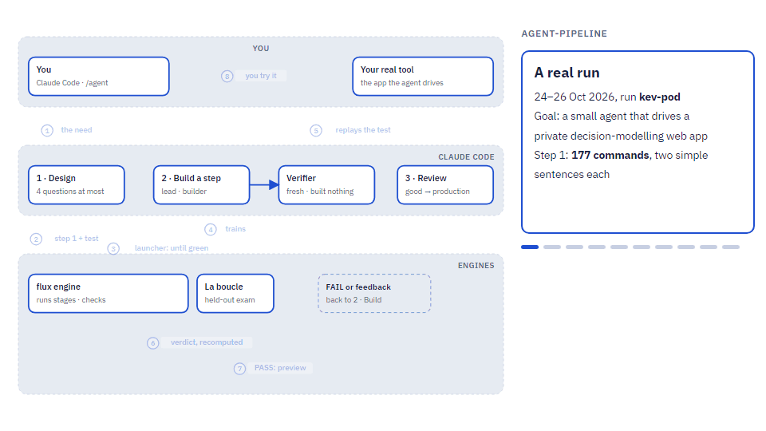
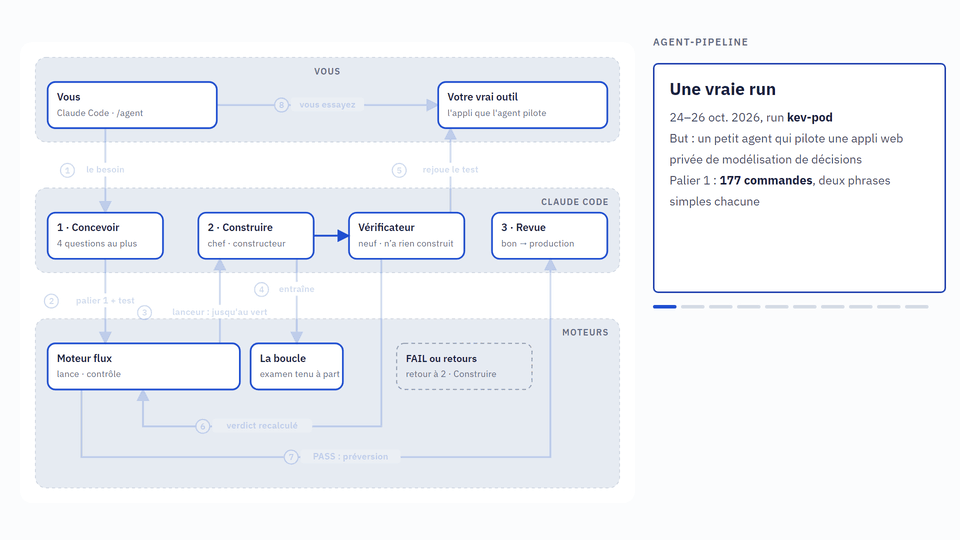

[English](README.md) · **Français**

# agent-pipeline

**Une pipeline Claude Code qui construit un agent spécialisé palier par palier : un vérificateur neuf rejoue le test de chaque palier dans votre vrai outil, et rien ne passe en production avant que vous disiez que c'est bon.**

[](https://drive.google.com/file/d/16JZCbsxif5BHSokTJLckyf_k8WhOriE5/view)

<details><summary>Animation en français</summary>

[](https://drive.google.com/file/d/1dxfElznnIjOWgkiLEHiA7Khc0hd_nT3p/view)

</details>

*Une vraie run, octobre 2026 : le palier 1 d'un agent qui pilote une appli web, du besoin à la production. [Vidéo complète (1:25)](https://drive.google.com/file/d/1dxfElznnIjOWgkiLEHiA7Khc0hd_nT3p/view)*

## Ce qu'on fait avec

- **Ouvrir une run.** `/agent <projet>` dans Claude Code ouvre un volet de suivi et une bande au-dessus de l'invite (dossier `mod/`) ; sans le mod, le skill `/agent-start`.
- **Concevoir en conversation.** Quatre questions au plus : le besoin mot pour mot, l'accès à votre vrai outil (rejoué une fois pour de vrai), la limite de votre machine, ce qui rend un palier prêt ; vos consignes réelles sont gardées comme test. L'agent propose ensuite le palier 1 : des commandes.
- **Construire un palier seul.** `tools/agent-lancer.py` relance l'étape 2 jusqu'à son contrôle vert (6 passes au plus ; arrêt après 3 sans progrès). Un constructeur écrit les données du palier et entraîne l'agent avec [La boucle](https://github.com/anthohunt/la-boucle-engine), noté sur un examen tenu à part ; le test du palier n'entre jamais dans l'entraînement.
- **Un verdict indépendant.** Lancé par le chef, un agent qui n'a rien construit compte ce que l'outil a vraiment fait pour chaque consigne du test. Le contrôle de la construction recalcule la réussite et les actions à tort depuis ces résultats : un verdict qui ne concorde pas échoue.
- **Vous décidez.** Vous essayez la préversion avec sa fiche « sait faire / ne sait pas encore ». « Bon » la met en production, puis palier suivant ou arrêt ; des retours, gardés mot pour mot, relancent la construction.

## Architecture


<details><summary>Diagramme en français</summary>


</details>

*La pipeline est jouée par [flux](https://github.com/anthohunt/flux), un moteur de pipelines d'agents (dépôt séparé).*

## Démarrage

Les agents de construction lancent des commandes sans demander (mode `dontAsk` de Claude Code, Bash autorisé) : utilisez une machine dédiée.

```bash
git clone https://github.com/anthohunt/agent-pipeline && cd agent-pipeline
git clone https://github.com/anthohunt/flux vendor/flux
git clone https://github.com/anthohunt/la-boucle-engine vendor/la-boucle-engine
python3 -m pip install -r vendor/flux/requirements.txt   # jsonschema
bash exemple/demo.sh   # de bout en bout en quelques secondes, sans compte ni modèle d'IA
```

`demo.sh` crée une run inventée dans `~/agent-runs`, montre le contrôle de l'étape 1 rouge sur une run vide puis les trois contrôles verts sur une run finie d'exemple, demande au lanceur ce qu'il ferait, puis entraîne un palier avec La boucle (note de 50 à 85).

<details><summary>Prérequis, réglages, tests, contenu du dépôt</summary>

- **Prérequis.** Linux ou macOS, `git`, Python 3.10+. De vrais agents demandent aussi `tmux` et Claude Code connecté.
- **Réglages.** Copier `.env.example` en `.env`, l'adapter, puis `set -a; . ./.env; set +a` : emplacement des moteurs (`FLUX_HOME`, `BOUCLE_HOME`), ce que flux lit (`FLUX_WORKFLOWS_DIR`, `FLUX_SKILLS_DIR`, `FLUX_VALIDATORS_PATH`), compte des agents (`AGENT_MOTEUR`), préfixe des commandes lourdes (`AGENT_LIMITEUR`).
- **Tests.** `python3 "$FLUX_HOME/runtime/verifier-graphes.py" workflows/*.json`, `python3 -m unittest discover -s tests` (72 tests : contrôles par mutation, lanceur, état), `python3 -m unittest discover -s mod/programme/tests` (15 tests).
- **Contenu.** `workflows/agent.json` (les 3 étapes), `skills/` (une consigne par agent), `validators/` (contrôles de fin d'étape), `tools/` (lanceur et état), `mod/` (mod de Claude Code), `docs/contrat.md` (contrat des fichiers), `exemple/`.
- **Pas fourni.** Ni l'outil que l'agent pilote, ni un modèle : vous apportez l'accès à votre outil et la limite de votre machine.

</details>

## État

- **Depuis octobre 2026.** Dépôt public depuis le 26 octobre.
- **Une vraie run.** Un petit agent (modèle de 0,8 milliard de paramètres + harnais, entraîné sans La boucle) pour une appli web privée de modélisation de décisions, rejoué dans une copie de test de l'appli ; phrases de test écrites par l'agent à la demande de l'utilisateur. Palier 1 (177 commandes) accepté le 26 octobre 2026 : 364 sur 394 réussies (92,4 %) et aucune action à tort, une fois les seules différences de majuscules admises par l'utilisateur. Palier 2 : aucun candidat à 90 % sans action à tort. En pause depuis le 4 novembre 2026.
- **Licences.** Code sous Apache 2.0 (`LICENSE`, `NOTICE`) ; skills, documentation et schémas sous CC BY 4.0 (`LICENSE-docs`). Tiers : [THIRD-PARTY.md](THIRD-PARTY.md).

---

**Anthony Hunt** · [ingevision.cloud](https://ingevision.cloud/?p=pipeline) · [LinkedIn](https://www.linkedin.com/in/anthony-hunt-3948a9196) · [GitHub](https://github.com/anthohunt)
