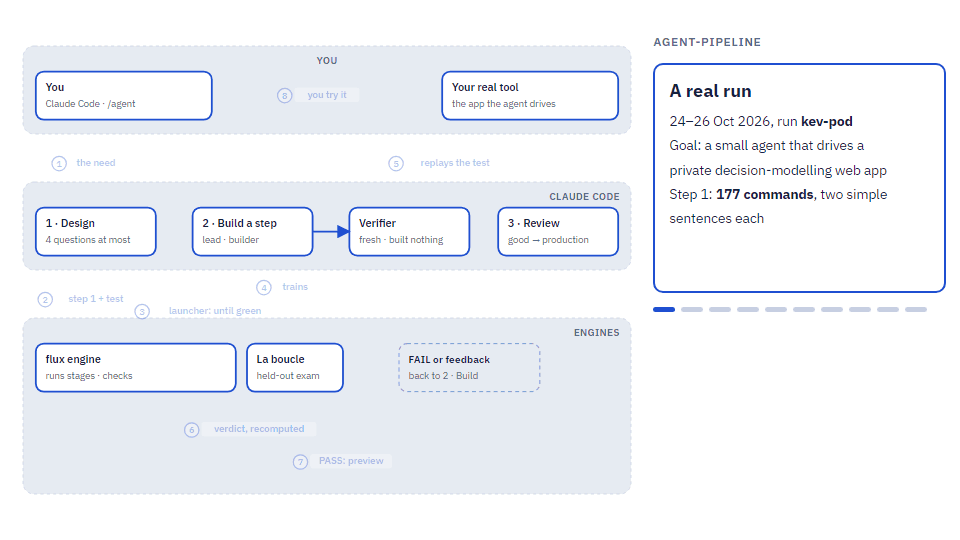

**English** · [Français](README.fr.md)

# agent-pipeline

**A Claude Code pipeline that builds a specialised agent one step at a time: a fresh verifier replays each step's test in your real tool, and nothing reaches production until you say it is good.**

[](https://drive.google.com/file/d/16JZCbsxif5BHSokTJLckyf_k8WhOriE5/view)

*A real run, October 2026: step 1 of an agent that drives a web app, from the need to production. [Full video (1:25)](https://drive.google.com/file/d/16JZCbsxif5BHSokTJLckyf_k8WhOriE5/view)*

## Using it

- **Start a run.** `/agent <project>` in Claude Code opens a tracking pane and a band above the prompt (the `mod/` folder); without the mod, the `/agent-start` skill.
- **Design in conversation.** Four questions at most: the need word for word, access to your real tool (replayed once for real), your real instructions, your machine's limit, the success rule. The agent then proposes step 1: a set of commands and its test.
- **Build a step on its own.** `tools/agent-lancer.py` restarts stage 2 until its check is green. A builder writes the step's data and trains the agent with [La boucle](https://github.com/anthohunt/la-boucle-engine), scored on a held-out exam; the step's test never enters training.
- **An independent verdict.** A fresh agent that built nothing replays every test instruction in your real tool and counts what the tool actually did. The build check recomputes the success rate and the wrongful actions from those results: a verdict that does not match fails.
- **You decide.** You try the preview with its "can do / cannot do yet" sheet. "Good" puts it in production, then the next step or a stop; feedback, kept word for word, sends the build back.

## Architecture


*The pipeline is played by [flux](https://github.com/anthohunt/flux), an agent pipeline engine (separate repository). Diagram in French: [architecture.svg](docs/architecture.svg).*

## Quick start

Build agents run commands without asking (Claude Code `dontAsk` mode, with Bash allowed): use a dedicated machine. Skills, docs and messages are in French.

```bash
git clone https://github.com/anthohunt/agent-pipeline && cd agent-pipeline
git clone https://github.com/anthohunt/flux vendor/flux
git clone https://github.com/anthohunt/la-boucle-engine vendor/la-boucle-engine
python3 -m pip install -r vendor/flux/requirements.txt   # jsonschema
bash exemple/demo.sh   # end to end in a few seconds, no account, no AI model
```

`demo.sh` creates an invented run in `~/agent-runs`, shows the stage 1 check red on an empty run and all three checks green on a finished sample, asks the launcher what it would do, then trains one step with La boucle (score from 50 to 85 on the held-out exam).

<details><summary>Requirements, settings, tests, repository</summary>

- **Requirements.** Linux or macOS, `git`, Python 3.10+. Real agents also need `tmux` and Claude Code signed in.
- **Settings.** Copy `.env.example` to `.env`, adapt it, then `set -a; . ./.env; set +a`: engine locations (`FLUX_HOME`, `BOUCLE_HOME`), what flux reads (`FLUX_WORKFLOWS_DIR`, `FLUX_SKILLS_DIR`, `FLUX_VALIDATORS_PATH`), the agents' account (`AGENT_MOTEUR`), a prefix for heavy commands (`AGENT_LIMITEUR`).
- **Tests.** `python3 "$FLUX_HOME/runtime/verifier-graphes.py" workflows/*.json`, `python3 -m unittest discover -s tests` (72 tests: checks by mutation, launcher, status), `python3 -m unittest discover -s mod/programme/tests` (15 tests).
- **Repository.** `workflows/agent.json` (the 3 stages), `skills/` (one instruction file per agent), `validators/` (end-of-stage checks), `tools/` (launcher and status), `mod/` (Claude Code mod), `docs/contrat.md` (file contract), `exemple/`.
- **Not included.** Neither the tool the agent drives nor a model: you bring access to your tool and the limit of your machine.

</details>

## Status

- **Since October 2026.** Built on 24 October 2026; public repository since 26 October.
- **One real run.** An agent for a private decision-modelling web app. Step 1 (177 commands) in production on 26 October 2026: 364 of 394 test sentences right (92.4 %), no wrongful action. Step 2 not passed: best 84.6 % with 1 wrongful action, against a rule of 90 % and 0 that is never lowered. Run paused since 4 November 2026.
- **Licences.** Code under Apache 2.0 (`LICENSE`, `NOTICE`); skills, docs and diagrams under CC BY 4.0 (`LICENSE-docs`). Third parties: [THIRD-PARTY.md](THIRD-PARTY.md).

---

**Anthony Hunt** · [ingevision.cloud](https://ingevision.cloud/?lang=en&p=pipeline) · [LinkedIn](https://www.linkedin.com/in/anthony-hunt-3948a9196) · [GitHub](https://github.com/anthohunt)
