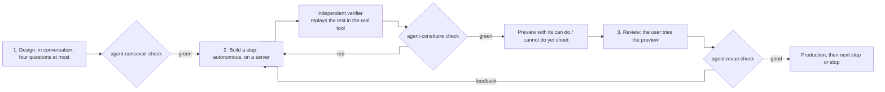
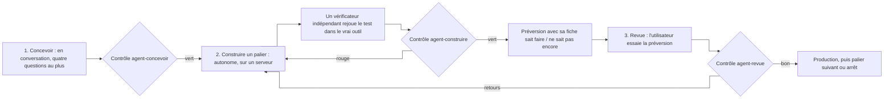

# agent-pipeline

A three-stage agent pipeline that builds a specialised agent step by step (*paliers*), the way software is built: a first version that knows little but does it well, then more complete versions, each one tried by the user in their real tool before it goes to production.



**English** · [Français](#version-française)

> The skills, docs, code comments and user-facing strings are in French.

## What it does

| # | Stage | Mode | End-of-stage check |
|---|---|---|---|
| 1 | **Design** | in conversation, four questions at most | `agent-concevoir` |
| 2 | **Build a step** | autonomous, on a server, restarted until green | `agent-construire` |
| 3 | **Review** | in conversation (human gate) | `agent-revue` |

1. **Design**: the need (word for word), access to the real tool (established by actually replaying an instruction), the user's **real instructions** (never generated, unless a quoted decision says otherwise), the machine's limit, what makes a step ready; then the agent **proposes and shows step 1 on its own**: about ten commands and their test.
2. **Build a step**: a builder writes the step's data and trains the agent; an **independent verifier** (a fresh agent that built nothing) replays each test instruction in the real tool, counts what the tool *actually* did, and returns PASS or FAIL against the user's criterion; delivery as a **preview**, with its "can do / cannot do yet" sheet. Nothing goes to production at this stage.
3. **Review**: the user tries the preview. "Good" puts it in production, then comes the next step (proposed and shown) or a stop; feedback, kept word for word, restarts the build on that step.

## How it works

Each stage has an **automatic check** (`validators/`) that judges its deliverables: while it is red, the next stage does not start. The build check recomputes the success rate and the wrongful actions from the replayed results: a verdict that does not match makes the node fail.

The pipeline is played by [**flux**](https://github.com/anthohunt/flux), an agent pipeline engine (separate repository, Apache 2.0): it reads the graphs, injects the instructions, starts the agents in Claude Code sessions and runs the checks. Stage 2 trains the agent of a step with the [**La boucle engine**](https://github.com/anthohunt/la-boucle-engine) (Apache 2.0, Python standard library only, `python3 -m boucle …`): measure, read the mistakes, try an idea, keep what improves the score; a **held-out share** of the step's data acts as the engine's exam, which the researcher never sees. The step's test (the real instructions) **never** enters the engine: only the verifier replays it.

### What is in the repository

| Folder | Content |
|---|---|
| `workflows/` | the graph `agent.json` (the 3 nodes) |
| `skills/` | the agents' instructions, one folder each (`<name>/SKILL.md`): `agent-concevoir`, `agent-construire` (the lead), `agent-construire.1` (the builder), `agent-construire.2` (the verifier), `agent-revue`, `agent-start` (fallback path) |
| `validators/` | the end-of-stage checks (`agent_concevoir.py`, `agent_construire.py`, `agent_revue.py`, `agent_commun.py`) |
| `tools/` | the stage 2 launcher (`agent-lancer.py`, which restarts it until green) and its status (`agent-etat.py`, one JSON line) |
| `mod/` | a Claude Code mod: tracking pane, band above the prompt, user decisions kept word for word (`/agent <project>`) |
| `docs/contrat.md` | the file contract between graph, tools and module |
| `exemple/` | `demo.sh` (end-to-end demonstration, no account needed) and `palier-1/` (training one step with La boucle, no AI model) |
| `tests/` | tests of the checks (by mutation), the launcher and the status tool |

## Requirements

- Linux or macOS, `git`, Python 3.10+, `pip`.
- [flux](https://github.com/anthohunt/flux) (required) and its `jsonschema` dependency.
- [la-boucle-engine](https://github.com/anthohunt/la-boucle-engine), for the build stage. Without it, stages 1 and 3, the checks, the launcher and the demonstration still work, except the last stage of `exemple/demo.sh`.
- To run real agents: `tmux` and Claude Code signed in to an account.

Third-party components and their licenses: [THIRD-PARTY.md](THIRD-PARTY.md).

## Install

```bash
git clone https://github.com/anthohunt/agent-pipeline agent-pipeline
cd agent-pipeline
git clone https://github.com/anthohunt/flux vendor/flux                          # the engine (see its own README)
git clone https://github.com/anthohunt/la-boucle-engine vendor/la-boucle-engine  # training
python3 -m pip install -r vendor/flux/requirements.txt                           # jsonschema
cp .env.example .env                                                             # then adapt the paths
set -a; . ./.env; set +a
```

Check the install:

```bash
python3 "$FLUX_HOME/runtime/verifier-graphes.py" workflows/*.json   # → GRAPHES CONFORMES
python3 -m unittest discover -s tests                              # checks, launcher, status
python3 -m unittest discover -s mod/programme/tests                 # module program
bash exemple/demo.sh                                                # end-to-end demonstration
```

`exemple/demo.sh` creates a run called "assistant-biblio" (an invented project), writes the brief of the design node with its instructions, shows the stage 1 check red on an empty run and then all three checks green on a finished sample run, reads the build status, asks the launcher what it would do, then trains one step with La boucle. **All of this runs without an account.** The design conversation and the build agents require Claude Code signed in.

### Usage

1. **New run**: in Claude Code, with the mod, `/agent <project>`; without the mod, the `/agent-start` skill (created by `python3 $FLUX_HOME/runtime/new-run.py agent '<project>'`).
2. **Design** in the same session: the four questions, then the proposed step 1.
3. **Build**: `python3 tools/agent-lancer.py <workspace>` starts stage 2 detached (one step, or one round of feedback) and restarts it until the check is green; `python3 tools/agent-etat.py <workspace>` tells you where it stands.
4. **Review**: the `agent-revue` skill (or the mod's pane); "good" puts it in production, feedback restarts the build.

### Settings

Everything that depends on the machine goes through environment variables, listed with sample values in `.env.example`: location of the engines (`FLUX_HOME`, `BOUCLE_HOME`), what flux reads to play this pipeline (`FLUX_WORKFLOWS_DIR`, `FLUX_SKILLS_DIR`, `FLUX_VALIDATORS_PATH`), the agents' account (`AGENT_MOTEUR`, an engine from flux's `moteurs.json`), prefix for heavy commands (`AGENT_LIMITEUR`).

### What this pipeline does not do

It provides neither the tool the agent must drive nor a model: the user gives access to **their** real tool and states the limit of **their** machine; an example that calls a paid AI model stops at the stage that requires an account.

## Licenses

- **Code** (Python, TypeScript, shell, JSON graph): [Apache 2.0](LICENSE), see [NOTICE](NOTICE).
- **Text, documents and diagrams** (instructions in `skills/*/SKILL.md`, `docs/`, README, graph text): [CC BY 4.0](LICENSE-docs). You may reuse and adapt them, crediting the author, Anthony Hunt.

## Its page

- English: <https://ingevision.cloud/?lang=en&p=pipeline>
- Français : <https://ingevision.cloud/?p=pipeline>

---

## Version française

# agent-pipeline

Une pipeline d'agents en trois étapes qui construit un agent spécialisé par paliers, comme un logiciel : une première version qui sait peu de choses mais les fait bien, puis des versions plus complètes, chacune essayée par l'utilisateur dans son vrai outil avant la production.



> Les skills, la documentation, les commentaires du code et les textes affichés sont en français.

### Ce qu'elle fait

| # | Étape | Mode | Contrôle de fin d'étape |
|---|---|---|---|
| 1 | **Concevoir** | en conversation, quatre questions au plus | `agent-concevoir` |
| 2 | **Construire un palier** | autonome, sur un serveur, relancée jusqu'au vert | `agent-construire` |
| 3 | **Revue** | en conversation (barrière humaine) | `agent-revue` |

1. **Concevoir** : le besoin (mot pour mot), l'accès à l'outil réel (constaté en rejouant une consigne pour de vrai), les **consignes réelles** de l'utilisateur (jamais générées, sauf décision citée), la limite de la machine, ce qui rend un palier prêt ; puis l'agent **propose et montre seul** le palier 1 : une dizaine de commandes et son test.
2. **Construire un palier** : un constructeur écrit les données du palier et entraîne l'agent ; un **vérificateur indépendant** (agent neuf, qui n'a rien construit) rejoue chaque consigne du test dans le vrai outil, compte ce que l'outil a *vraiment* fait, et rend PASS ou FAIL au critère de l'utilisateur ; livraison en **préversion**, avec sa fiche « sait faire / ne sait pas encore ». Jamais de production à cette étape.
3. **Revue** : l'utilisateur essaie la préversion. « Bon » la met en production, puis palier suivant (proposé et montré) ou arrêt ; des retours, gardés mot pour mot, relancent la construction sur ce palier.

### Comment elle marche

Chaque étape a un **contrôle automatique** (`validators/`) qui juge ses livrables : tant qu'il est rouge, l'étape suivante ne démarre pas. Le contrôle de la construction recalcule la réussite et les actions à tort depuis les résultats rejoués : un verdict qui ne concorde pas fait échouer le nœud.

La pipeline est jouée par [**flux**](https://github.com/anthohunt/flux), un moteur de pipelines d'agents (dépôt séparé, Apache 2.0) : il lit les graphes, injecte les consignes, lance les agents dans des sessions Claude Code et passe les contrôles. L'étape 2 entraîne l'agent d'un palier avec le [**moteur de La boucle**](https://github.com/anthohunt/la-boucle-engine) (Apache 2.0, bibliothèque standard Python seule, `python3 -m boucle …`) : mesurer, lire les fautes, essayer une idée, garder ce qui monte ; une **part tenue à part** des données du palier joue l'examen du moteur, que le chercheur ne voit jamais. Le test du palier (les consignes réelles) n'entre **jamais** dans le moteur : seul le vérificateur le rejoue.

#### Contenu du dépôt

| Dossier | Ce qu'il contient |
|---|---|
| `workflows/` | le graphe `agent.json` (les 3 nœuds) |
| `skills/` | les consignes des agents, une par dossier (`<nom>/SKILL.md`) : `agent-concevoir`, `agent-construire` (le chef), `agent-construire.1` (le constructeur), `agent-construire.2` (le vérificateur), `agent-revue`, `agent-start` (chemin de secours) |
| `validators/` | les contrôles de fin d'étape (`agent_concevoir.py`, `agent_construire.py`, `agent_revue.py`, `agent_commun.py`) |
| `tools/` | le lanceur de l'étape 2 (`agent-lancer.py`, qui la relance jusqu'au vert) et son état (`agent-etat.py`, une ligne JSON) |
| `mod/` | un mod de Claude Code : volet de suivi, bande au-dessus de l'invite, décisions de l'utilisateur gardées mot pour mot (`/agent <projet>`) |
| `docs/contrat.md` | le contrat des fichiers entre graphe, outils et module |
| `exemple/` | `demo.sh` (démonstration de bout en bout sans compte) et `palier-1/` (l'entraînement d'un palier avec La boucle, sans modèle d'IA) |
| `tests/` | tests des contrôles (par mutation), du lanceur et de l'état |

### Ce qu'il faut

- Linux ou macOS, `git`, Python 3.10+, `pip`.
- [flux](https://github.com/anthohunt/flux) (obligatoire) et sa dépendance `jsonschema`.
- [la-boucle-engine](https://github.com/anthohunt/la-boucle-engine), pour l'étape de construction. Sans lui, les étapes 1 et 3, les contrôles, le lanceur et la démonstration fonctionnent, sauf la dernière étape de `exemple/demo.sh`.
- Pour lancer de vrais agents : `tmux` et Claude Code connecté à un compte.

Composants tiers et leurs licences : [THIRD-PARTY.md](THIRD-PARTY.md).

### Installer

```bash
git clone https://github.com/anthohunt/agent-pipeline agent-pipeline
cd agent-pipeline
git clone https://github.com/anthohunt/flux vendor/flux                          # le moteur (voir son propre README)
git clone https://github.com/anthohunt/la-boucle-engine vendor/la-boucle-engine  # l'entraînement
python3 -m pip install -r vendor/flux/requirements.txt                           # jsonschema
cp .env.example .env                                                             # puis adapter les chemins
set -a; . ./.env; set +a
```

Vérifier l'installation :

```bash
python3 "$FLUX_HOME/runtime/verifier-graphes.py" workflows/*.json   # → GRAPHES CONFORMES
python3 -m unittest discover -s tests                              # contrôles, lanceur, état
python3 -m unittest discover -s mod/programme/tests                 # programme du module
bash exemple/demo.sh                                                # démonstration de bout en bout
```

`exemple/demo.sh` crée une run « assistant-biblio » (projet inventé), écrit le brief du nœud « concevoir » avec ses consignes, montre le contrôle de l'étape 1 rouge sur une run vide puis vert pour les trois contrôles sur une run finie d'exemple, lit l'état de la construction, demande au lanceur ce qu'il ferait, puis entraîne un palier avec La boucle. **Tout cela tourne sans compte.** La conversation de conception et les agents de construction exigent Claude Code connecté.

#### Utiliser

1. **Nouvelle run** : dans Claude Code, avec le mod, `/agent <projet>` ; sans le mod, le skill `/agent-start` (création par `python3 $FLUX_HOME/runtime/new-run.py agent '<projet>'`).
2. **Concevoir** dans la même session : les quatre questions, puis le palier 1 proposé.
3. **Construire** : `python3 tools/agent-lancer.py <workspace>` lance l'étape 2 en détaché (un palier, ou un tour de retours) et la relance jusqu'au contrôle vert ; `python3 tools/agent-etat.py <workspace>` dit où elle en est.
4. **Revue** : skill `agent-revue` (ou le volet du mod) ; « bon » met en production, des retours relancent la construction.

#### Réglages

Tout ce qui dépend de la machine passe par des variables d'environnement, listées avec des valeurs d'exemple dans `.env.example` : emplacement des moteurs (`FLUX_HOME`, `BOUCLE_HOME`), ce que flux lit pour jouer cette pipeline (`FLUX_WORKFLOWS_DIR`, `FLUX_SKILLS_DIR`, `FLUX_VALIDATORS_PATH`), compte des agents (`AGENT_MOTEUR`, un moteur de `moteurs.json` de flux), préfixe des commandes lourdes (`AGENT_LIMITEUR`).

#### Ce que cette pipeline ne fait pas

Elle ne fournit ni l'outil que l'agent doit piloter, ni un modèle : l'utilisateur donne l'accès à **son** outil réel et la limite de **sa** machine ; un exemple qui appelle un modèle d'IA payant s'arrête à l'étape qui demande un compte.

### Licences

- **Code** (Python, TypeScript, shell, graphe JSON) : [Apache 2.0](LICENSE), voir [NOTICE](NOTICE).
- **Textes, documents et schémas** (consignes `skills/*/SKILL.md`, `docs/`, README, textes du graphe) : [CC BY 4.0](LICENSE-docs). Vous pouvez les réutiliser et les adapter en citant l'auteur, Anthony Hunt.

### Sa fiche projet

- Français : <https://ingevision.cloud/?p=pipeline>
- English: <https://ingevision.cloud/?lang=en&p=pipeline>

---

**Anthony Hunt** · [Project page on ingevision.cloud](https://ingevision.cloud/?lang=en&p=pipeline) · [LinkedIn](https://www.linkedin.com/in/anthony-hunt-3948a9196) · [GitHub profile](https://github.com/anthohunt) · anthony@ingevision.cloud
